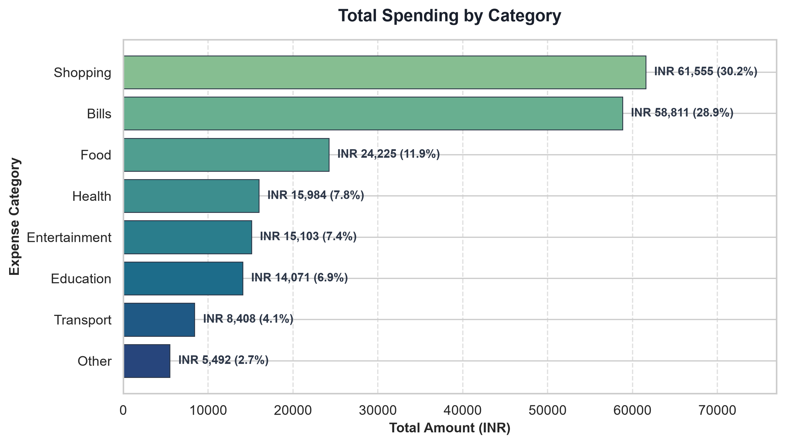
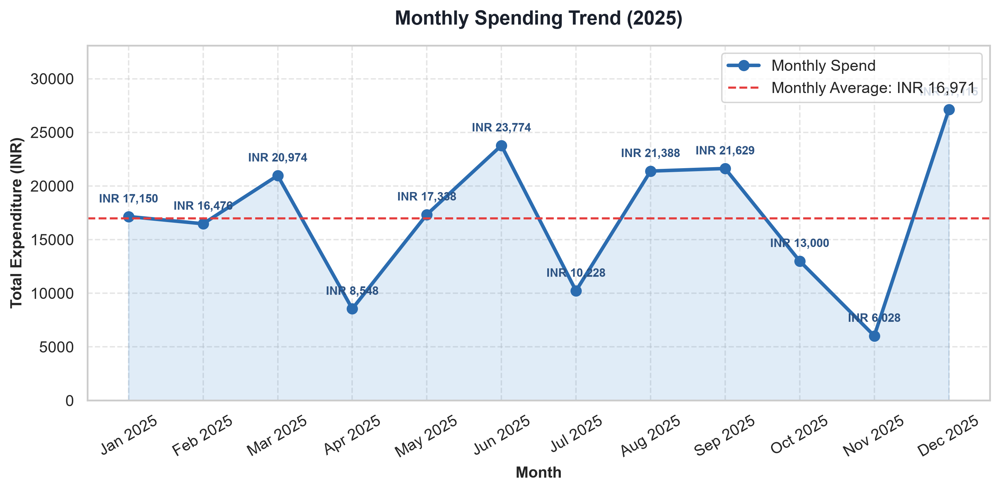
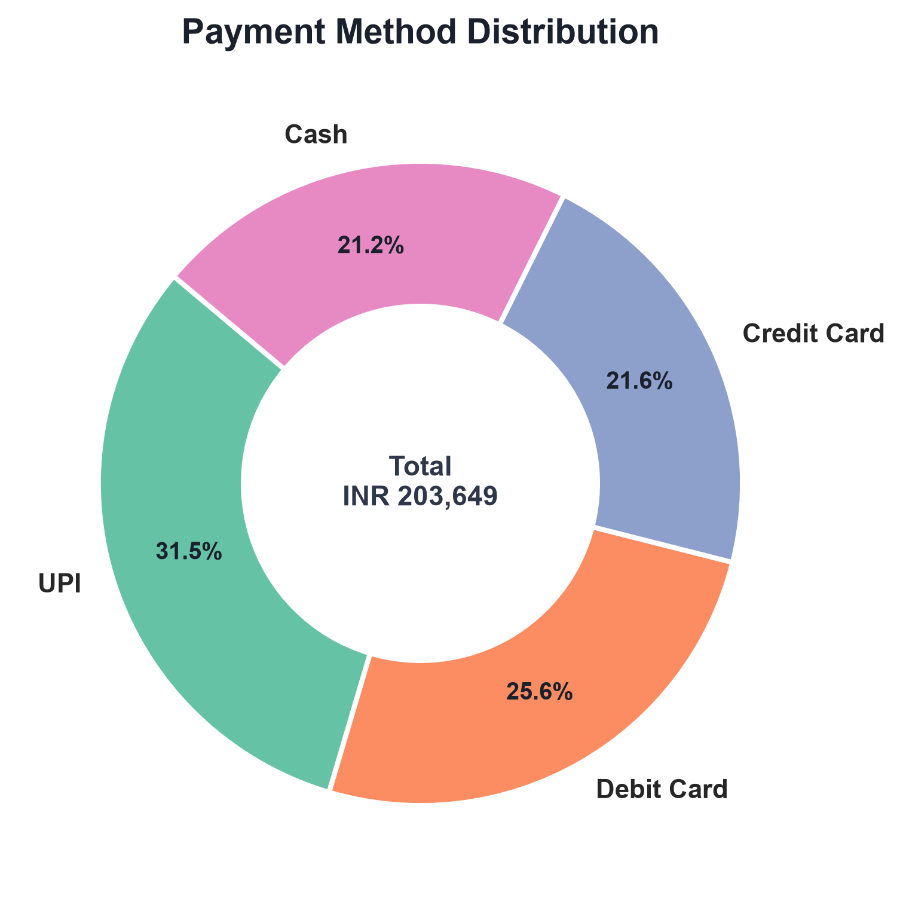
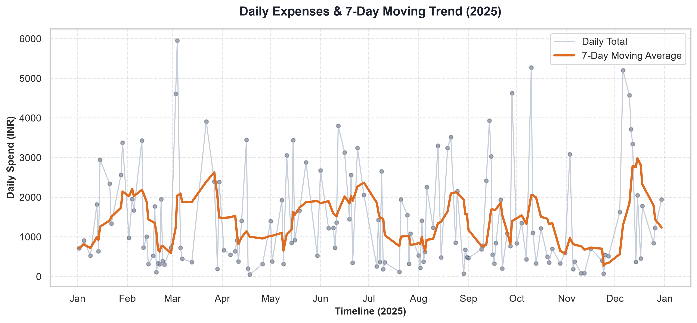

# 💸 Personal Expense Tracker with Data Visualization

[](https://www.python.org/)
[](https://pandas.pydata.org/)
[](https://streamlit.io/)
[](LICENSE)

An end-to-end, production-style personal finance analytics and data visualization application designed as a student portfolio project. It demonstrates automated data cleaning, local SQLite data persistence, statistical analysis, publication-grade charting with Matplotlib and Seaborn, and a responsive web dashboard built with Streamlit.

---

## 📌 Table of Contents
- [Problem Statement & Objectives](#-problem-statement--objectives)
- [Key Features](#-key-features)
- [System Architecture](#-system-architecture)
- [Project Directory Structure](#-project-directory-structure)
- [Dataset Details](#-dataset-details)
- [Installation & Quickstart](#-installation--quickstart)
- [Running the CLI Pipeline](#-running-the-cli-pipeline)
- [Launching the Streamlit Dashboard](#-launching-the-streamlit-dashboard)
- [Visualizations & Key Insights](#-visualizations--key-insights)
- [Test Suite & QA Verification](#-test-suite--qa-verification)
- [Limitations & Future Scope](#-limitations--future-scope)
- [Synthetic Data Disclaimer](#-synthetic-data-disclaimer)

---

## 🎯 Problem Statement & Objectives

Managing personal expenses is a fundamental financial habit, but tracking transactions in raw spreadsheets often lacks actionable insights, automated validation, and clear visual communication.

### Objectives
1. **Automated ETL:** Build a clean data pipeline that validates raw CSV transactions, removes invalid records/dates/amounts, and standardizes categories.
2. **Persistent Storage:** Store clean financial transactions in a local SQLite database with zero-duplicate upserting.
3. **Analytics Engine:** Compute core financial metrics (e.g., ticket averages, category concentrations, active daily burn rates, and budget variance).
4. **Visual Storytelling:** Generate publication-quality figures representing categorical, temporal, and payment distribution patterns.
5. **Interactive Exploration:** Provide an intuitive, modern web dashboard for real-time filtering, budget adjustment, custom file uploads, and report exports.

---

## 🚀 Key Features

- **Automated Data Cleaning & Validation:** Standardizes header casing, parses inconsistent dates, coerces numeric amounts, drops non-positive values, and fills missing descriptions.
- **SQLite Database Persistence:** Clean transactions are automatically mirrored into a local SQLite database (`data/expenses.db`) with clean refresh semantics.
- **10 Core Analytical Metrics:** Including Total Expenditure, Transaction Volume, Average Ticket Size, Category Breakdown, Monthly Aggregates, Payment Distributions, and Active-Day Spend Rates.
- **Budget Variance Tracking:** Compares actual expenditures against target monthly category allocations with live status alerts (*Within Budget* vs. *Exceeded Budget*).
- **Four Publication-Ready Charts:**
  1. *Category-Wise Spending* (Bar Chart with percentage labels)
  2. *Monthly Spending Trend* (Line Chart with average benchmark)
  3. *Payment Method Breakdown* (Donut Chart)
  4. *Daily Spending & 7-Day Moving Trend* (Time-Series with smoothing)
- **Multi-Format Export Engine:** Generates 4 separate structured CSV summaries alongside an executive text report (`summary_report.txt`).
- **Interactive Web Dashboard (Streamlit):**
  - Multi-dimensional sidebar filters (Date intervals, Categories, Payment modes).
  - Custom user CSV uploader with synthetic fallback.
  - Interactive budget threshold modifier.
  - Filtered transaction table with text search.
  - One-click CSV and Text Report downloads.

---

## 🏗️ System Architecture

```text
+---------------------+       +----------------------+       +-----------------------+
|  Raw / Uploaded CSV | ----> | src/data_manager.py  | ----> |   data/expenses.db    |
| (data/expenses.csv) |       |  (Cleaning & SQLite) |       |   (Local SQLite DB)   |
+---------------------+       +----------------------+       +-----------------------+
                                          |
                                          v
                              +----------------------+
                              |   src/analysis.py    |
                              |  (Analytics Engine)  |
                              +----------------------+
                                     /         \
                                    v           v
                    +--------------------+  +--------------------+
                    |   src/charts.py    |  |   src/report.py    |
                    | (Seaborn & Mpl)    |  |  (CSVs & TXT Rep)  |
                    +--------------------+  +--------------------+
                               |                      |
                               +-----------+----------+
                                           |
                         +-----------------+-----------------+
                         v                                   v
             +-----------------------+           +-----------------------+
             |        main.py        |           |        app.py         |
             |   (CLI Pipeline)      |           | (Streamlit Dashboard) |
             +-----------------------+           +-----------------------+
```

---

## 📂 Project Directory Structure

```text
Personal-Expense-Tracker-Visualization/
│
├── data/
│   ├── expenses.csv             # 180 synthetic transactions (Year 2025)
│   ├── expenses.db              # Local SQLite database
│   └── README.md                # Data documentation & synthetic notice
│
├── docs/
│   ├── architecture.md          # Component architecture & design notes
│   ├── interview_prep.md        # Technical interview Q&A & project pitch
│   ├── PROGRESS.md              # Milestone timeline & bug tracking log
│   └── setup_guide.md           # Beginner setup & run guide
│
├── images/                      # Saved charts for portfolio showcase
│   ├── category_expenses.png
│   ├── daily_expenses.png
│   ├── monthly_trend.png
│   └── payment_distribution.png
│
├── notebooks/
│   ├── exploratory_analysis.ipynb # Jupyter Notebook for EDA & prototyping
│   └── README.md
│
├── outputs/                     # Generated charts from pipeline run
│   ├── category_expenses.png
│   ├── daily_expenses.png
│   ├── monthly_trend.png
│   └── payment_distribution.png
│
├── reports/                     # Generated CSV and text summaries
│   ├── category_summary.csv
│   ├── cleaned_transactions.csv
│   ├── monthly_summary.csv
│   ├── payment_method_summary.csv
│   └── summary_report.txt
│
├── src/
│   ├── __init__.py
│   ├── analysis.py              # Statistical metrics & budget engine
│   ├── charts.py                # Seaborn / Matplotlib visual generators
│   ├── data_manager.py          # Data ingestion, cleaning, & SQLite
│   ├── report.py                # Multi-format report exporter
│   └── utils.py                 # Cross-platform safe I/O layer
│
├── tests/
│   └── test_pipeline.py         # Automated unittest test suite
│
├── .gitignore                   # Git exclusions (venv, caches, OS files)
├── app.py                       # Streamlit web dashboard entry point
├── main.py                      # Automated CLI pipeline entry point
├── README.md                    # Project landing documentation
└── requirements.txt             # Project library dependencies
```

---

## 📊 Dataset Details

- **Records:** 180 realistic synthetic transactions spanning **Jan 01, 2025 to Dec 31, 2025**.
- **Reproducibility:** Seeded with `numpy.random.seed(42)`.
- **Columns:**
  - `Date`: Transaction date (`YYYY-MM-DD`).
  - `Category`: `Food`, `Transport`, `Shopping`, `Bills`, `Health`, `Education`, `Entertainment`, `Other`.
  - `Amount`: Expense value in currency units (e.g., INR).
  - `Payment_Method`: `Cash`, `UPI`, `Debit Card`, `Credit Card`.
  - `Description`: Realistic transaction particulars (e.g., *Groceries at supermarket*, *Metro smart card recharge*).

---

## ⚙️ Installation & Quickstart

### Prerequisites
- Python 3.10+ (Tested on **Python 3.13.17** on Windows).

### Clone and Setup Environment
```powershell
# Navigate into project directory
cd Personal-Expense-Tracker-Visualization

# (Optional) Create a virtual environment
python -m venv venv
.\venv\Scripts\activate

# Install required dependencies
pip install -r requirements.txt
```

---

## 💻 Running the CLI Pipeline

Execute the complete end-to-end data pipeline from the command line:

```powershell
# Using your Python environment:
python main.py
```

### Execution Output:
```text
================================================================================
       PERSONAL EXPENSE TRACKER & DATA VISUALIZATION PIPELINE
       Autonomous Student Portfolio Build | Python 3.13 | Pandas
================================================================================

[1/7] Checking dataset availability...
      -> Loaded 180 raw records.
[2/7] Running data cleaning & schema validation...
      -> Successfully validated and cleaned 180 transactions.
[3/7] Storing clean transactions in local SQLite database...
      -> Synchronized 180 records into 'data/expenses.db'.
[4/7] Computing financial metrics and statistical aggregates...
      -> Total Expenditure : INR 203,648.66
      -> Transaction Count : 180
      -> Average Ticket    : INR 1,131.38
      -> Top Category      : Shopping (INR 61,555.10, 30.23%)
[5/7] Generating professional charts...
      -> Created category_expenses.png, monthly_trend.png, etc.
[6/7] Exporting summary CSVs and comprehensive text report...
      -> Exported cleaned_transactions.csv, summary_report.txt, etc.
[7/7] Pipeline execution summary:
================================================================================
CATEGORY              SPENT (INR)      SHARE    COUNT             STATUS
--------------------------------------------------------------------------------
Shopping                61,555.10      30.2%       27    Exceeded Budget
Bills                   58,811.46      28.9%       24    Exceeded Budget
Food                    24,224.61      11.9%       48      Within Budget
Health                  15,983.72       7.8%       13    Exceeded Budget
Entertainment           15,102.72       7.4%       19    Exceeded Budget
Education               14,071.31       6.9%        9    Exceeded Budget
Transport                8,407.73       4.1%       29      Within Budget
Other                    5,492.01       2.7%       11      Within Budget
================================================================================
[SUCCESS] Entire pipeline completed in 5.82 seconds!
```

---

## 🌐 Launching the Streamlit Dashboard

Start the interactive visual application in your browser:

```powershell
streamlit run app.py
```

Open `http://localhost:8501` to access:
- **Interactive Controls:** Filter by date, category, and payment methods in real-time.
- **Custom CSV Ingestion:** Drag and drop your own transaction CSV to analyze personal records.
- **Dynamic Budget Allocations:** Adjust monthly limits and monitor live surplus/deficit statuses.
- **Data Export Center:** Download filtered datasets or full executive text reports.

---

## 📈 Visualizations & Key Insights

| Chart | Preview | Key Insight |
|---|---|---|
| **Category Spending** |  | **Shopping** and **Bills** constitute ~59% of all annual outflows, highlighting primary optimization opportunities. |
| **Monthly Trend** |  | Spending exhibits natural mid-year and holiday year-end peaks (Dec 2025 peak at INR 27,114.78). |
| **Payment Breakdown** |  | Digital payments (UPI & Cards) dominate over 85% of total payment volume, showing low reliance on cash. |
| **Daily Moving Trend** |  | 7-day rolling average reveals steady baseline spending with periodic weekend spikes. |

---

## 🧪 Test Suite & QA Verification

The project includes an automated test suite verifying edge cases, invalid inputs, and calculation formulas:

```powershell
python -m unittest tests/test_pipeline.py
```

### Verified Test Cases:
- `test_synthetic_data_generation`: Confirms record count, date span, and category membership.
- `test_data_cleaning`: Validates removal of NaT dates, negative costs, and duplicate transactions.
- `test_cleaning_invalid_inputs`: Asserts recovery from dirty column names and missing fields.
- `test_sqlite_roundtrip`: Verifies atomic table writing and reading from `expenses.db`.
- `test_analysis_metrics`: Checks mathematical precision of totals, averages, and groupings.
- `test_empty_dataframe_handling`: Ensures zero-division safety on empty datasets.

---

## 🔭 Limitations & Future Scope

### Current Limitations:
- Single-currency model (INR / standard numeric currency).
- Standalone local SQLite database (single user).

### Future Roadmap:
- **Predictive ML Forecasting:** Train an ARIMA or Prophet time-series model to predict month-end expenses based on mid-month run-rate.
- **OCR Receipt Scanning:** Connect Tesseract or Gemini Vision API to convert paper receipts into transactions automatically.
- **Cloud Database Integration:** Support remote PostgreSQL or BigQuery data warehouses for multi-device sync.

---

## ⚠️ Synthetic Data Disclaimer

All transaction dates, descriptions, amounts, and personal details in this repository are **100% synthetically generated** for educational and portfolio demonstration purposes. No real personal banking credentials or financial transactions are stored.

---

## 👨‍💻 Author & Portfolio Information
Built with Python, Pandas, Matplotlib, Seaborn, and Streamlit.