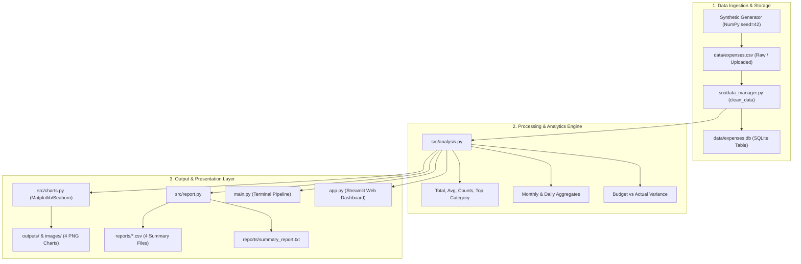

# System Architecture and Component Design

This document details the software architecture, data flow, and module responsibilities of the **Personal Expense Tracker with Data Visualization**.

---

## 1. High-Level Architecture Diagram



---

## 2. Component Directory

| Module / Component | Primary Responsibilities |
|---|---|
| **`src/data_manager.py`** | Synthetic data generation, raw CSV ingestion, schema validation, date coercion, null removal, category standardization, and SQLite table synchronization. |
| **`src/analysis.py`** | Pure functional analytics calculations (totals, averages, monthly/daily grouping, top spending category, budget comparison). Resilient against empty DataFrames. |
| **`src/charts.py`** | High-resolution figure creation using Matplotlib and Seaborn. Creates bar, line, donut, and moving average charts. Compatible with both headless file saving and Streamlit rendering. |
| **`src/report.py`** | Formats multi-category text reports and exports structured CSV summaries (`cleaned_transactions.csv`, `category_summary.csv`, `monthly_summary.csv`, `payment_method_summary.csv`). |
| **`src/utils.py`** | Safe I/O abstraction layer. Provides staging and atomic file copy routines that overcome Windows Defender Controlled Folder Access restrictions. |
| **`main.py`** | Automated CLI runner that orchestrates data verification, cleaning, storage, calculations, chart creation, and terminal reporting. |
| **`app.py`** | Interactive Streamlit web application providing live filtering, interactive budget management, charts, and file downloads. |
| **`tests/test_pipeline.py`** | Automated unittest suite verifying data generation, cleaning logic, SQLite roundtrip, calculation accuracy, and empty-state safety. |

---

## 3. Database Schema (`data/expenses.db`)

Cleaned transactions are persisted in a local SQLite table named `expenses`:

```sql
CREATE TABLE IF NOT EXISTS expenses (
    id INTEGER PRIMARY KEY AUTOINCREMENT,
    date TEXT NOT NULL,
    category TEXT NOT NULL,
    amount REAL NOT NULL,
    payment_method TEXT NOT NULL,
    description TEXT
);
```

### Duplicate Prevention Strategy:
To avoid accumulating duplicate records when `main.py` is rerun, `save_to_sqlite` executes an atomic replacement:
1. Clears existing table records: `DELETE FROM expenses;`
2. Appends newly validated and cleaned records.